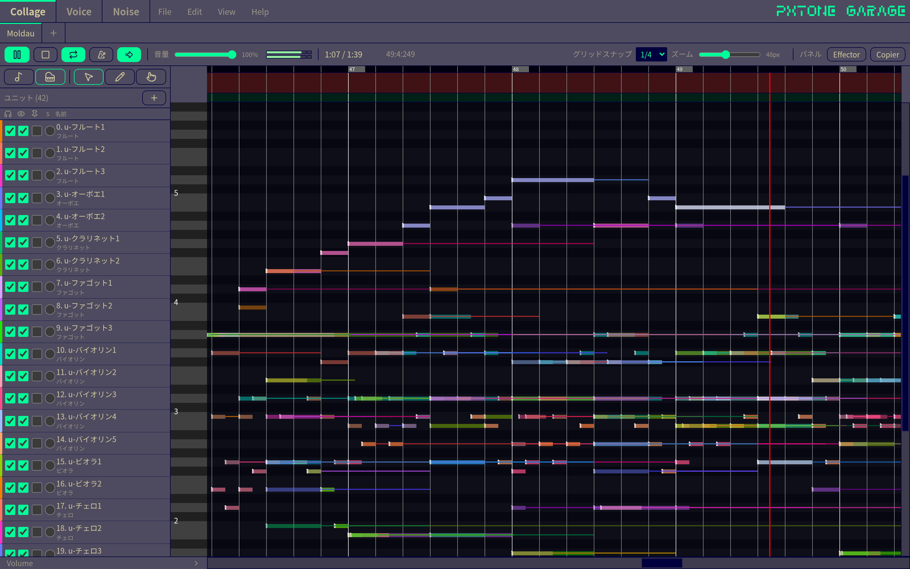

# ピストンガラージュ

[ピストンコラージュ](https://pxtone.org/) 互換の Web DAW アプリケーション。

アプリ内のタブで ptCollage / ptVoice / ptNoise を切り替えて制作できます。



[サンプル曲を再生](https://pxtone.pithos.day/?sample=moldau)

再生エンジン: [pxtone-ts](https://github.com/pithos-day/pxtone-ts)

## 機能

**Collage**

- ptcop の読み込み / 保存、pttune の読み込み (再生専用) / 書き出し、MIDI の読み込み
- ピアノロールとイベントレーンでのノート / イベント編集
- 範囲のコピー / 貼り付け / 移調 / クオンタイズなどの一括編集
- ptvoice / ptnoise / WAV / OGG の音色の追加と、Voice / Noise タブでの編集
- Delay / OverDrive、メトロノーム、出力レベルメーター
- WAV 書き出し (ユニット別の ZIP 書き出しにも対応)

**Voice / Noise**

- Voice: 座標波形 / 倍音、エンベロープの編集
- Noise: レイヤーとオシレータ、エンベロープの編集
- WAV 書き出し、Collage への追加

**共通**

- タブごとの undo / redo、未保存の編集の自動復元
- テーマ (インポート / エクスポート可)、フォント、キー割り当ての変更
- 日本語 / English

## 動作環境

PC のブラウザのほか、Windows / macOS / Linux 向けのスタンドアロン版 ([Releases](https://github.com/pithos-day/pxtone-garage/releases)) で動作します。どちらもネットワークなしで使えます (ブラウザ版は一度開いた後)。

スタンドアロン版はコード署名をしていないため、初回起動時に警告が出ます。Windows は「詳細情報」→「実行」、macOS は Finder でアプリを右クリックして「開く」で起動できます (開けない場合はシステム設定の「プライバシーとセキュリティ」から許可してください)。

モバイル端末は公式サポートではありませんが、横向きの PC と同じレイアウトでタッチ操作できます (右ドラッグなどマウス前提の操作は使えません)。

## キーボードショートカット

既定の割り当てです。File > 環境設定 > キー設定から変更できます。

| キー | 動作 |
| --- | --- |
| Ctrl+Z / Ctrl+Y | 元に戻す / やり直す |
| Ctrl+S / Ctrl+Shift+S | 保存 / 名前を付けて保存 |
| Ctrl+A / Ctrl+Shift+A | 範囲の全選択 / ユニットの全選択 |
| Ctrl+C / Ctrl+X / Ctrl+V | 範囲のコピー / 切り取り / 貼り付け |
| Delete / Shift+Delete | 範囲の消去 (前詰め) / クリア |
| Esc | ノートの選択を解除 |
| ← → / ↑ ↓ | 1 拍 / 1 行スクロール |
| Space | 再生 / 停止 |
| Home / End | 先頭 / 末尾へシーク |
| F1 / F2 | 音色管理 (W) / ユニット (U) |
| 1 / 2 / 3 | スマート / ペン / ハンドツール |

## 開発

```bash
pnpm install
pnpm dev            # 開発サーバーを起動 (http://localhost:5173)
pnpm build          # 本番ビルド
pnpm electron       # スタンドアロン版をビルドして起動
pnpm dist:electron  # スタンドアロン版をパッケージ (release/)
```

```
src/
├── engine/      # AudioWorklet プレイヤー / プレビュー / ファイル IO
├── state/       # プロジェクト状態 / 再生 / undo / 設定
├── lib/         # 純粋ロジック / 描画ヘルパ
├── composables/
├── i18n/
├── themes/
├── styles/
└── components/  # shell / collage / voice / noise / common
electron/        # スタンドアロン版のメインプロセス
```

## 検証

```bash
pnpm test                               # ロジックのテスト (tests/)
pnpm exec playwright install chromium   # E2E の初回のみ
pnpm test:e2e                           # ブラウザ版とスタンドアロン版の E2E テスト (e2e/)
```

## 謝辞

ピストンコラージュの開発者である[開発室Pixel](https://studiopixel.jp)氏に感謝。

また、このプロジェクトのデザインと実装の参考にさせていただいた、以下のプロジェクトに感謝します。

- [ptweb](https://github.com/yuxshao/ptweb)
- [ptcollab](https://github.com/yuxshao/ptcollab)

## License

[MIT](./LICENSE)
